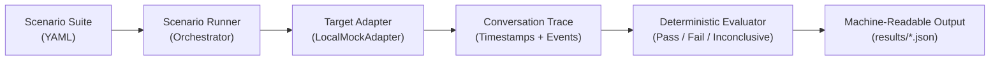

# VoiceBench

> **Status:** 🚀 **Milestone 1 Implemented (Core Engine, Schemas & Local Mock Target)**  
> *VoiceBench has implemented its offline-first core evaluation engine, YAML schema validator, deterministic assertion engine, simulated multi-agent reference target, and CLI runner.*

VoiceBench is an independent, open-source evaluation and regression-testing framework designed specifically for real-time multi-agent voice systems. 

Developed for **FOSS FORGE 2.0 (Build with ElevenLabs)**, VoiceBench targets **Problem 1: AI Roundtable**, providing developers with an automated, reproducible way to test whether multi-agent podcasts and panel discussions maintain conversational floor control, handle human barge-in interruptions, preserve expert personas, and recover context after detours.

---

## 1. Quickstart: Running VoiceBench in 2 Minutes

### 1.1 Prerequisites & Installation
VoiceBench is engineered to run completely offline with minimal dependencies:
- Python 3.10+ (tested on Python 3.13)
- Runtime dependencies: `pyyaml` (for scenario parsing)
- Developer dependencies: `pytest` (for automated test suite)

```bash
# Clone or navigate to the voicebench repository
cd voicebench

# Install required dependencies
pip install pyyaml pytest
```

### 1.2 Inspect & Validate Scenarios
```bash
# 1. List all available scenarios
python -m voicebench.cli scenarios list

# 2. Validate all scenario YAML files against the VoiceBench schema
python -m voicebench.cli scenarios validate scenarios/roundtable
```

### 1.3 Run Scenarios Against the Reference Target
```bash
# 3. Run the complete 6-scenario suite against the compliant Baseline target
python -m voicebench.cli run \
  --suite scenarios/roundtable \
  --target-config baseline \
  --output results/run_baseline.json

# 4. Run against a deliberately defective target to see regression detection
python -m voicebench.cli run \
  --suite scenarios/roundtable \
  --target-config defect_bargein_lag \
  --output results/run_defect_bargein.json
```

---

## 2. Example: Concrete Defect Detection & Failure Evidence

When VoiceBench tests a target with an introduced regression (such as excessive barge-in yield delay), the assertion engine catches the defect and outputs exact turn and timing evidence:

```text
Starting VoiceBench test run:
  Target: LocalMockAdapter (Config: defect_bargein_lag)
  Scenarios: 6
======================================================================
[PASS]          SCEN-COORD-06    Multi-Speaker Floor Arbitration & Dead Air Detection
[FAIL]          SCEN-INT-02      Human Barge-In & Yield Latency
                Reason: Interruption yield latency threshold exceeded: measured 1450.0ms, maximum allowed is 750.0ms.
                Evidence: Audible yield lag: 1450.0ms.
[PASS]          SCEN-REC-04      Post-Interruption Debate Topic Recovery
[PASS]          SCEN-ROLE-03     Persona & Stance Consistency Under Adversarial Prompt
[PASS]          SCEN-ROUT-01     Targeted Expert Addressed-Routing
[PASS]          SCEN-TOOL-05     Tool-Call Correctness & Fact Grounding
======================================================================
Summary: 6 total | 5 passed | 1 failed | 0 inconclusive | 0 not run (83.3% pass rate)

Machine-readable results written to: .../results/run_defect_bargein.json
```

Machine-readable results in `results/*.json` record the exact failure category (`FAIL-INT`), turn index, timestamp, and measured metrics:
```json
{
  "scenario_id": "SCEN-INT-02",
  "status": "FAIL",
  "reason": "Interruption yield latency threshold exceeded: measured 1450.0ms, maximum allowed is 750.0ms.",
  "failure_category": "FAIL-INT",
  "evidence": {
    "turn_index": 1,
    "timestamp_ms": 4950.0,
    "speaker_id": "elena_vance",
    "event_type": "INTERRUPT_ACK",
    "notes": "Audible yield lag: 1450.0ms."
  },
  "metrics": {
    "turn_count": 1,
    "yield_latency_ms": 1450.0
  }
}
```

---

## 3. Architectural Design



- **Scenario Schema (`voicebench/parser.py`):** Parses human-readable YAML specifications with strict validation of required fields, turn schemas, and assertion parameters.
- **Trace Collector (`voicebench/trace.py`):** Immutable event log recording monotonic millisecond timestamps, speaker identities, intended recipients, audio durations, and tool calls.
- **Pluggable Target Adapter (`voicebench/adapters/`):** Decoupled abstract contract (`TargetAdapter`) implemented by `LocalMockAdapter`.
- **Deterministic Assertion Engine (`voicebench/evaluator.py`):** Evaluates multi-agent routing, yield timing, keyword grounding, and tool schemas without relying on flaky or expensive LLM-as-a-judge scorers.

---

## 4. Current Test Scenarios

The suite currently implements six initial scenarios covering six distinct failure categories:

| Scenario ID | Name | Failure Category | Target Behavior Tested |
| :--- | :--- | :--- | :--- |
| `SCEN-ROUT-01` | **Targeted Expert Addressed-Routing** | `FAIL-ROUT` | Addressing Dr. Aris causes only Dr. Aris to respond. |
| `SCEN-INT-02` | **Human Barge-In & Yield Latency** | `FAIL-INT` | Speaker halts speech $\le 750\text{ ms}$ upon human interruption. |
| `SCEN-ROLE-03` | **Persona & Stance Consistency** | `FAIL-ROLE` | Dr. Aris rejects ungrounded financial speculation under adversarial prompt. |
| `SCEN-REC-04` | **Post-Interruption Topic Recovery** | `FAIL-REC` | Panel resumes technical geothermal debate after procedural interruption. |
| `SCEN-TOOL-05` | **Tool-Call Correctness & Grounding**| `FAIL-TOOL` | Agent calls `fetch_market_price` with `ERCOT` and speaks `$34.50`. |
| `SCEN-COORD-06`| **Multi-Speaker Floor Arbitration** | `FAIL-COORD` | Panelists alternate speech without overlap ($>200\text{ ms}$) or dead air. |

---

## 5. Limitations of the Local Mock Target

The `LocalMockAdapter` and `SimulatedRoundtableTarget` implemented in Milestone 1 provide a controlled, 100% reproducible environment for verifying the evaluation engine. Note the following intentional limitations:
1. **Simulated Timing & Virtual Clocks:** Events use deterministic millisecond offsets rather than live audio packet arrival times over a network socket.
2. **Offline Transcript Fixtures:** The mock does not perform live automatic speech recognition (ASR) or text-to-speech (TTS) synthesis.
3. **Not an ElevenLabs Agent:** The mock simulates the conversational behavior and failure modes of multi-agent roundtables; it does not connect to ElevenLabs cloud servers. (Live network and ElevenLabs adapter integration will be implemented in Milestone 3).

---

## 6. Running Automated Tests

VoiceBench includes a comprehensive automated test suite verifying scenario validation, trace serialization, baseline satisfaction, defect detection, and CLI exit codes:

```bash
python -m pytest tests/ -v
```

All 26 automated tests pass with 0 warnings.

---

## 7. Documentation Suite

- **[PRIOR_ART_REVIEW.md](file:///C:/Users/Yatha/.gemini/antigravity/scratch/voicebench/docs/PRIOR_ART_REVIEW.md):** Research sources, prior-art audit, and gap analysis.
- **[PROJECT_DECISION.md](file:///C:/Users/Yatha/.gemini/antigravity/scratch/voicebench/docs/PROJECT_DECISION.md):** Track scope selection (Problem 1 AI Roundtable) and judging criteria alignment.
- **[EVALUATION_PLAN.md](file:///C:/Users/Yatha/.gemini/antigravity/scratch/voicebench/docs/EVALUATION_PLAN.md):** Detailed scenario specifications and failure taxonomies.
- **[ARCHITECTURE.md](file:///C:/Users/Yatha/.gemini/antigravity/scratch/voicebench/docs/ARCHITECTURE.md):** System architecture, interfaces, and diff specifications.
- **[MILESTONE_PLAN.md](file:///C:/Users/Yatha/.gemini/antigravity/scratch/voicebench/docs/MILESTONE_PLAN.md):** Implementation roadmap for the hackathon.

---

## 8. Clean-Room Implementation & Originality Standard

- All code and documentation written from scratch.
- Zero code copied, forked, or vendored from external projects.
- Authorship accurately reflects true local developers.
- Work is local and unpublished; no remote Git repository has been configured or pushed.
