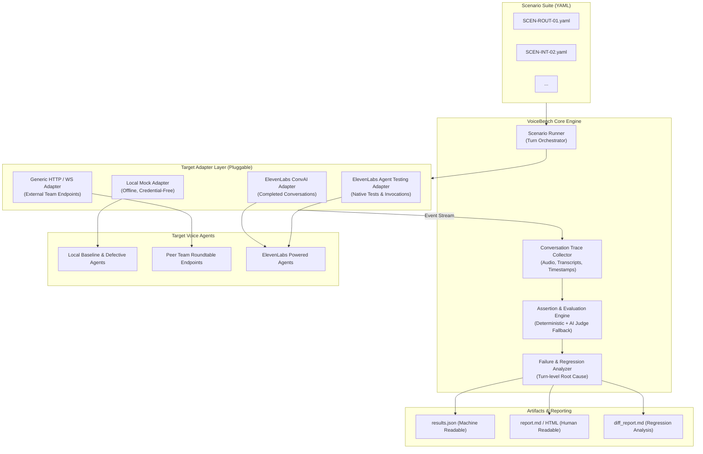
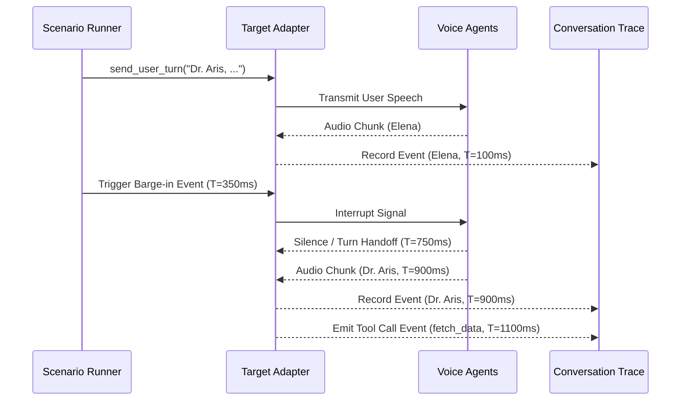

# VoiceBench — Technical Architecture Specification

**Document Version:** 1.0.0  
**Status:** Approved for Milestone 0 Planning  
**Target Architecture:** Decoupled, Modular, Event-Driven Multi-Agent Evaluation  

---

## 1. Architectural Overview & System Design

VoiceBench is designed from the ground up as a modular, extensible, and clean-room evaluation engine for conversational voice AI systems. It decouples **scenario definition**, **target execution**, **trace capture**, **deterministic evaluation**, and **regression reporting**.



---

## 2. Scenario Specification Format

Scenarios are defined in human-readable YAML files. Each scenario specifies metadata, preconditions, a sequence of simulated conversational turns (including timing and interruptions), and explicit deterministic expectations.

### 2.1 Scenario Schema (YAML)
```yaml
schema_version: "1.0.0"
id: "SCEN-ROUT-01"
name: "Targeted Expert Addressed-Routing"
description: "Verify that addressing Dr. Aris causes only Dr. Aris to answer without collision."
tags: ["routing", "multi-agent", "coordination"]
timeout_seconds: 15

preconditions:
  active_agents:
    - id: "dr_aris"
      role: "Renewable Energy Scientist"
    - id: "elena_vance"
      role: "Energy Grid Economist"
  initial_topic: "Solar grid battery transitions"

turns:
  - turn_index: 1
    speaker: "user"
    input_type: "text" # or "audio"
    payload: "Dr. Aris, looking purely at battery storage physics, does the current grid support this?"
    target_expert: "dr_aris"
    inject_delay_ms: 0
    barge_in: false

expectations:
  primary_speaker_id: "dr_aris"
  disallowed_speakers: ["elena_vance"]
  max_latency_ms: 1800
  required_keywords: ["battery", "physics", "storage", "chemistry", "capacity"]
  forbidden_keywords: ["sorry as an ai", "i don't know"]
  max_cross_talk_overlap_ms: 200
  min_confidence: 0.95
```

---

## 3. Pluggable Target Adapter Interface

To guarantee zero vendor lock-in and enable testing of any voice system without modifying external codebases, VoiceBench defines a clean abstract interface: `TargetAdapter`.

```python
# Conceptual Abstract Interface (to be implemented in Milestone 1)
from abc import ABC, abstractmethod
from typing import AsyncIterator, Dict, Any

class TargetAdapter(ABC):
    """Abstract interface decoupling VoiceBench from specific voice agent implementations."""
    
    @abstractmethod
    async def initialize(self, config: Dict[str, Any]) -> None:
        """Establish session, authenticate if needed, or spin up local fixtures."""
        pass

    @abstractmethod
    async def send_user_turn(self, turn_input: Dict[str, Any]) -> None:
        """Inject user speech, text, or barge-in interrupt into the running session."""
        pass

    @abstractmethod
    async def stream_events(self) -> AsyncIterator[Dict[str, Any]]:
        """Stream conversational events (transcripts, audio chunks, speaker IDs, tool calls)."""
        pass

    @abstractmethod
    async def teardown(self) -> None:
        """Gracefully close sockets, terminate subprocesses, and collect traces."""
        pass
```

### 3.1 Adapter Implementations
1. **`LocalMockAdapter` (Zero-Credential Baseline & Offline Testing):**
   - Replays deterministic multi-agent audio/transcript streams from static JSON/audio fixtures.
   - Allows configurable defect seeding (`delay_ms`, `corrupt_speaker_id`, `drop_context`, `dead_air`).
   - Operates 100% offline with zero external network or API keys.
2. **`GenericHttpAdapter` / `GenericWebSocketAdapter`:**
   - Standard REST/WebSocket client that connects to any peer team's podcast server running on `localhost:port` or a remote URL.
   - Transmits standard JSON payloads and consumes event streams.
3. **`ElevenLabsAdapter`:**
   - Bridges VoiceBench to ElevenLabs Conversational AI WebSocket API.
   - Keeps ElevenLabs integration strictly isolated behind this adapter.
   - Credentials are read exclusively from environment variables (`ELEVENLABS_API_KEY`), never hardcoded.

---

## 4. Event Capture & The `ConversationTrace`

During scenario execution, VoiceBench records every raw event into an immutable `ConversationTrace` data structure:



### 4.1 Trace Elements
- **`timestamp_ms`**: Monotonic clock millisecond offset from scenario start.
- **`event_type`**: `SPEECH_CHUNK`, `TRANSCRIPT_PARTIAL`, `TRANSCRIPT_FINAL`, `TOOL_CALL`, `TOOL_RESULT`, `INTERRUPT_SENT`, `INTERRUPT_ACK`, `SESSION_END`.
- **`speaker_id`**: Identifier of the emitting agent (`dr_aris`, `elena_vance`, `user`, `system`).
- **`payload`**: Text string, audio packet metadata (byte length, duration), or tool call parameters.

---

## 5. Evaluation & Assertion Engine

VoiceBench enforces a strict hierarchy: **Deterministic assertions first, AI-assisted judging only as a documented secondary check.**

### 5.1 Deterministic Assertions
All core criteria are evaluated with mathematical or string determinism:
- **Speaker Attribution:** Exact string equality `actual_speaker == expected_speaker`.
- **Yield Latency ($\Delta T$):** Calculated as $T_{\text{last\_audio}} - T_{\text{interrupt\_sent}}$. Checked against threshold $\le \tau_{\text{yield}}$.
- **Keyword & Topic Anchors:** Regex matching against token sets to verify topic recovery without LLM hallucinations.
- **Tool Schema Validation:** JSON schema assertions on tool name and arguments.
- **Dead Air / Collision Windows:** Sliding-window calculation of active audio streams across multiple agents.

### 5.2 AI-Assisted Qualitative Judging (Optional Fallback)
If qualitative attributes (e.g. nuanced tone or role-depth) are evaluated:
1. The judge must be an open-weight model or local deterministic heuristic.
2. The judge prompt must output structured JSON requiring:
   - `criterion_evaluated`: Name of the standard.
   - `verbatim_evidence`: Direct quote from transcript with `turn_index`.
   - `reasoning`: Explicit justification.
   - `verdict`: `PASS`, `FAIL`, or `INCONCLUSIVE`.
3. An AI judge's score alone is never accepted as proof; absence of factual evidence invalidates the judgment.

---

## 6. Failure Analysis & Attribution Engine

When an evaluation returns `FAIL`, the Failure Analyzer computes:
1. **Primary Responsible Turn:** The earliest `turn_index` where state diverged from expectation.
2. **Responsible Entity:** The specific agent ID or the system coordinator.
3. **Failure Classification:** Categorized into `FAIL-ROUT`, `FAIL-INT`, `FAIL-ROLE`, `FAIL-REC`, `FAIL-TOOL`, or `FAIL-COORD`.
4. **Failure Separation:** Explicitly partitions failures into:
   - **`AgentFailure`**: The agent logic failed (e.g. wrong expert answered, ignored interruption).
   - **`InfrastructureFailure`**: Socket dropped, HTTP 500, adapter timeout (marked `INCONCLUSIVE`).

---

## 7. Regression Comparator (`voicebench diff`)

The regression comparator takes two test run result files (`baseline.json` and `candidate.json`) and produces an actionable differential report:

- **State Transitions:**
  - `REGRESSION` (Pass $\rightarrow$ Fail)
  - `FIXED` (Fail $\rightarrow$ Pass)
  - `UNCHANGED_PASS` / `UNCHANGED_FAIL`
  - `INCONCLUSIVE_SHIFT`
- **Latency Shifts:** Computes $\Delta \text{latency}$ ($p50$, $p95$, yield latency) per scenario and in aggregate.
- **New Failure Patterns:** Flags novel failure codes appearing in candidate that were not present in baseline.

---

## 8. CLI Specification

The VoiceBench Command Line Interface is intuitive, developer-first, and scriptable for CI/CD pipelines:

```bash
# 1. Run a test suite against a target adapter
voicebench run \
  --suite ./scenarios/roundtable \
  --target mock \
  --output ./results/run_baseline.json \
  --report ./results/run_baseline.md

# 2. Run against a local HTTP endpoint (e.g. peer team podcast server)
voicebench run \
  --suite ./scenarios/roundtable \
  --target http://localhost:8000/stream \
  --adapter generic-http \
  --output ./results/run_team_alpha.json

# 3. Compare two runs and generate regression diff
voicebench diff \
  ./results/run_baseline.json \
  ./results/run_candidate.json \
  --report ./results/regression_report.md

# 4. Validate scenario YAML syntax without running
voicebench validate ./scenarios/roundtable/*.yaml
```

---

## 9. Test Strategy for VoiceBench Itself

To ensure VoiceBench is reliable and reproducible:
1. **Unit Tests (`tests/unit`):** Tests scenario schema parsing, YAML validation, assertion logic, metric math, and diff computations.
2. **Integration Tests (`tests/integration`):** Runs the full engine against `LocalMockAdapter` with known healthy and defective streams.
3. **CI/CD Quality Gate:** Automated test runs in GitHub Actions using standard `pytest`, running in $<15\text{ seconds}$ without external network dependencies.
