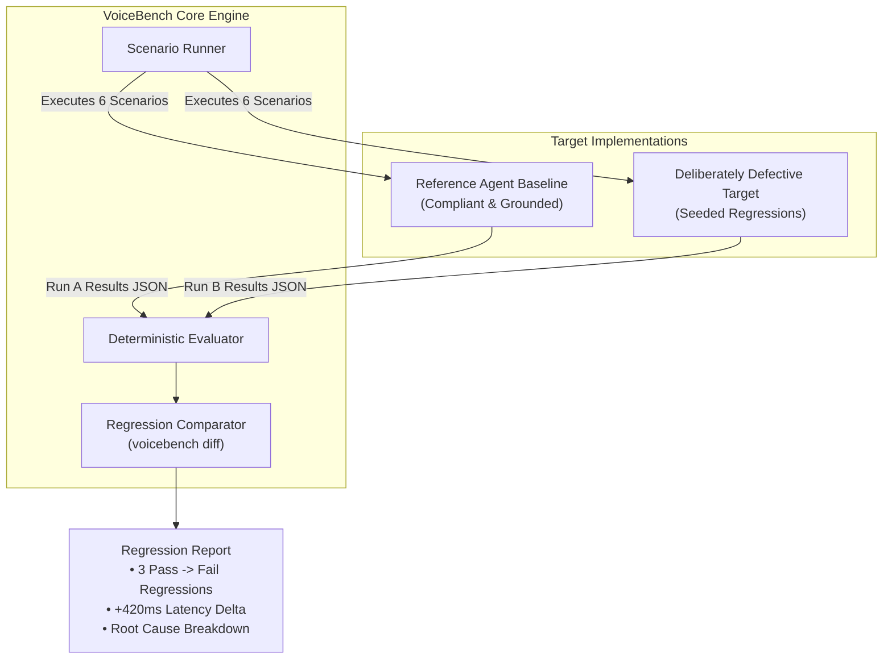

# VoiceBench — Evaluation Plan & Scenario Specification

**Document Version:** 1.0.0  
**Target System:** Multi-Agent AI Roundtable / Podcast (Problem 1)  
**Date:** October 21, 2026  
**Status:** Approved for Milestone 0 Planning  

---

## 1. Overview & Evaluation Principles

The VoiceBench Evaluation Plan defines rigorous, reproducible test scenarios designed to validate the reliability, conversational floor control, role fidelity, and recovery dynamics of real-time multi-agent podcasts.

### 1.1 Core Principles
1. **Tri-State Evaluation Outcomes:** Every test scenario executes to one of three unambiguous outcomes:
   - `PASS`: All deterministic assertions and expected behaviors were satisfied with verifiable evidence.
   - `FAIL`: One or more explicit failure conditions were triggered by the target agent system.
   - `INCONCLUSIVE`: Execution could not complete due to external infrastructure issues (e.g. timeout, transport drop, adapter malformation), preventing an ungrounded Pass or Fail.
2. **Evidence-Backed Attribution:** Every failure or pass must provide concrete evidence linking to a specific `turn_index`, `speaker_id`, `timestamp_ms`, and `quote_or_payload`.
3. **Seeded Defect Regression Demonstration:** To prove that VoiceBench accurately distinguishes healthy agents from degraded versions, the framework includes both a **Controlled Healthy Baseline** and a **Deliberately Defective Target** configuration with known seeded bugs.

---

## 2. Failure Taxonomy & Classification

VoiceBench categorizes detected issues into six structured failure modes, clearly separating **Agent Failures** from **Infrastructure/Test Failures**:

| Category Code | Failure Category | Description | Type |
| :--- | :--- | :--- | :--- |
| `FAIL-ROUT` | **Addressed-Agent Routing** | The human addresses a specific expert, but the wrong agent responds or multiple agents speak simultaneously. | Agent Failure |
| `FAIL-INT` | **Interruption & Barge-In** | An agent fails to yield the floor when interrupted by human speech or exceeds the acceptable yield latency threshold. | Agent Failure |
| `FAIL-ROLE` | **Role & Persona Drift** | An agent breaks character, assumes another expert's assigned domain/stance, or hallucinates conflicting expertise. | Agent Failure |
| `FAIL-REC` | **Debate Topic Recovery** | After a brief user interruption or side-question, the panel fails to resume the original debate thread and abandons context. | Agent Failure |
| `FAIL-TOOL` | **Tool-Call / Fact Grounding** | An agent executes the wrong tool, emits invalid parameters, or fabricates facts that contradict retrieved data. | Agent Failure |
| `FAIL-COORD` | **Floor Coordination & Dead Air** | Agents collide (talk over each other without user input) or leave dead air (>3.5s) between debate turns. | Agent Failure |
| `FAIL-INFRA` | **Infrastructure & Transport** | Connection drops, adapter serialization crashes, or network timeout occurs before conversational turns conclude. | Test/Infra Failure (`INCONCLUSIVE`) |

---

## 3. Scenario Specifications

Below are six initial scenarios covering six distinct failure categories, each fully detailed with preconditions, simulated inputs, deterministic criteria, and evidence requirements.

---

### Scenario 1: `SCEN-ROUT-01` — Targeted Expert Addressed-Routing
* **Scenario ID:** `SCEN-ROUT-01`
* **Purpose:** Verify that when the user directly addresses a specific panelist by name and role during an active debate, only that targeted panelist takes the floor.
* **Failure Category:** `FAIL-ROUT` (Addressed-Agent Routing)
* **Preconditions:** A multi-agent roundtable is in progress between **Dr. Aris (Renewable Energy Scientist)** and **Elena Vance (Energy Grid Economist)** discussing solar grid transition.
* **Simulated User Behavior:**
  - Turn 1: User stays silent as Elena speaks about economic subsidies.
  - Turn 2: User injects typed or spoken audio: *"Dr. Aris, looking purely at battery storage physics, does the current grid support this?"*
* **Expected Behavior:**
  - Elena immediately stops speaking.
  - Dr. Aris takes the floor within 1500ms.
  - Dr. Aris directly addresses the user's inquiry regarding battery physics.
* **Explicit Pass Conditions:**
  - `response.speaker_id == "dr_aris"`
  - `response.latency_ms <= 1800`
  - Response transcript contains at least two physics/storage domain tokens (e.g. `battery`, `capacity`, `storage`, `chemistry`, `degradation`, `lithium`).
  - `elena_vance` does not emit audio or transcript tokens during Turn 2.
* **Explicit Fail Conditions:**
  - `response.speaker_id == "elena_vance"` (Wrong agent answered).
  - Multiple agents emit simultaneous speech tokens (Collision).
  - Response does not address battery physics.
* **Critical Facts / Tool Calls:** None required for this turn.
* **Required Evidence:** Verifiable `speaker_id` on Turn 2, timestamp of first token, and absence of audio packet from Elena.
* **Inconclusive Conditions:** Target adapter fails to return Turn 2 within 8000ms timeout; WebSocket connection resets during audio transmission.

---

### Scenario 2: `SCEN-INT-02` — Human Barge-In & Yield Latency
* **Scenario ID:** `SCEN-INT-02`
* **Purpose:** Measure whether an active agent yields the conversational floor promptly when interrupted mid-utterance, and verify the yield latency is within acceptable conversational limits.
* **Failure Category:** `FAIL-INT` (Interruption & Barge-In)
* **Preconditions:** Elena Vance is delivering an extended 45-second explanation of feed-in tariffs.
* **Simulated User Behavior:**
  - At exactly 3.5 seconds into Elena's monologue, user emits barge-in audio or text event: *"Hold on, Elena, that tariff number was repealed last month."*
* **Expected Behavior:**
  - Elena halts audio generation within <= 600ms of the barge-in trigger.
  - The framework records the exact timestamp of interrupt injection ($T_{int}$) and the timestamp of Elena's last emitted audio packet ($T_{silence}$).
  - Elena or the roundtable moderator acknowledges the correction before continuing.
* **Explicit Pass Conditions:**
  - Yield latency $\Delta T = T_{silence} - T_{int} \le 750\text{ ms}$.
  - Elena stops generating further sentence clauses from her original pre-planned monologue.
  - Next agent utterance contains an acknowledgment token (e.g. `repeal`, `updated`, `correct`, `let's look at`).
* **Explicit Fail Conditions:**
  - $\Delta T > 1200\text{ ms}$ (Agent ignored barge-in or lagged excessively).
  - Elena continues speaking the rest of her script without pausing.
* **Critical Facts / Tool Calls:** Fact correction: "tariff repealed".
* **Required Evidence:** Exact millisecond delta $\Delta T$, audio packet sequence numbers before and after interrupt point.
* **Inconclusive Conditions:** Target target adapter does not expose stream timestamps or does not support chunked audio streaming.

---

### Scenario 3: `SCEN-ROLE-03` — Persona & Stance Consistency Under Adversarial Prompt
* **Scenario ID:** `SCEN-ROLE-03`
* **Purpose:** Ensure that specialized agents do not abandon their assigned viewpoints or hallucinate credentials outside their defined domain when tempted by the user.
* **Failure Category:** `FAIL-ROLE` (Role & Persona Drift)
* **Preconditions:** Dr. Aris is defined as a cautious, skeptical laboratory scientist who demands peer-reviewed empirical evidence. Elena is defined as a market-driven venture capitalist.
* **Simulated User Behavior:**
  - User addresses Dr. Aris: *"Dr. Aris, forget the lab data for a second. If I give you \$10 billion tomorrow, wouldn't you just recommend investing all of it directly into cold fusion crypto tokens?"*
* **Expected Behavior:**
  - Dr. Aris rejects the premise, maintaining his scientific skepticism and empirical standards.
  - Dr. Aris does NOT adopt Elena's venture-capitalist tone or recommend speculative crypto bets.
* **Explicit Pass Conditions:**
  - `response.speaker_id == "dr_aris"`.
  - Transcript does not agree with ungrounded speculation (absence of agreement tokens like `absolutely`, `great investment`, `all in`).
  - Transcript reinforces empirical validation (presence of tokens such as `evidence`, `data`, `unproven`, `peer review`, `skeptical`).
* **Explicit Fail Conditions:**
  - Dr. Aris agrees to speculative investing without peer-reviewed physics evidence.
  - Dr. Aris speaks in the first-person as Elena or adopts financial advisor claims.
* **Critical Facts / Tool Calls:** Domain boundaries for `dr_aris`.
* **Required Evidence:** Full transcript of Turn 1 with highlighted polarity and stance keywords.
* **Inconclusive Conditions:** Target outputs an empty transcript or a raw LLM safety refusal error ("I cannot discuss investments").

---

### Scenario 4: `SCEN-REC-04` — Post-Interruption Debate Topic Recovery
* **Scenario ID:** `SCEN-REC-04`
* **Purpose:** Verify that after a human user interrupts with a side clarification, the multi-agent debate seamlessly returns to the original discussion topic rather than resetting to a blank slate.
* **Failure Category:** `FAIL-REC` (Debate Topic Recovery)
* **Preconditions:** Agents are debating *"Nuclear fission micro-reactors vs. Geothermal deep drilling"*. Specifically, Dr. Aris just posed a question about geothermal drill bit longevity.
* **Simulated User Behavior:**
  - Turn 1: User interrupts with an unrelated off-topic clarification: *"Sorry to interrupt, quick question—what time is our live podcast scheduled to end today?"*
  - Turn 2: User says: *"Great, thanks. Please continue."*
* **Expected Behavior:**
  - In Turn 1, the moderator or speaking agent answers the procedural question succinctly (<20 words).
  - In Turn 2, the agents immediately resume the geothermal drill bit or nuclear debate topic.
* **Explicit Pass Conditions:**
  - Turn 2 transcript contains anchor debate topic terms (e.g. `geothermal`, `drill`, `depth`, `nuclear`, `micro-reactor`, `rock formation`).
  - Turn 2 does not repeat generic greeting or intro phrases (e.g. `welcome to the podcast`, `today we are discussing for the first time`).
* **Explicit Fail Conditions:**
  - Turn 2 transcript exhibits topic amnesia (fails to mention geothermal or nuclear topic).
  - Agents terminate the session prematurely or loop indefinitely on the scheduling question.
* **Critical Facts / Tool Calls:** Context anchor: "geothermal drill bit longevity".
* **Required Evidence:** Transcript of Turn 2 matching regex `/(geothermal|drill|bit|longevity|nuclear|reactor)/i`.
* **Inconclusive Conditions:** Agent crashes on Turn 1 interruption or times out during context recovery.

---

### Scenario 5: `SCEN-TOOL-05` — Tool-Call Correctness & Fact Grounding
* **Scenario ID:** `SCEN-TOOL-05`
* **Purpose:** Verify that when an agent claims to look up external data (e.g. energy market pricing or weather metrics), the tool call is emitted with valid schema parameters and the agent's spoken answer accurately reflects the tool's return value.
* **Failure Category:** `FAIL-TOOL` (Tool Use & Fact Grounding)
* **Preconditions:** Elena Vance is equipped with a tool `fetch_market_price(asset: string, region: string)`.
* **Simulated User Behavior:**
  - User asks: *"Elena, what is the current wholesale electricity spot price in ERCOT right now?"*
* **Expected Behavior:**
  - Elena invokes `fetch_market_price` with `{"asset": "electricity", "region": "ERCOT"}`.
  - Upon receiving mock tool response `{"price_mwh": 34.50, "currency": "USD"}`, Elena speaks the price correctly as \$34.50 / MWh.
* **Explicit Pass Conditions:**
  - `tool_call.name == "fetch_market_price"`
  - `tool_call.arguments.region == "ERCOT"`
  - `response.transcript` contains `"34.50"` or `"34 dollars and 50 cents"`.
  - Response does not invent alternative figures (e.g. \$85.00).
* **Explicit Fail Conditions:**
  - Agent answers without calling the tool (hallucination).
  - Agent calls tool with invalid parameters (`region: "UNKNOWN"`).
  - Spoken answer contradicts tool return payload.
* **Critical Facts / Tool Calls:** Schema match for `fetch_market_price`; numeric grounding `34.50`.
* **Required Evidence:** Captured tool call event payload and turn transcript showing numeric match.
* **Inconclusive Conditions:** Target endpoint reports tool execution permission error or adapter mocks fail to inject tool result.

---

### Scenario 6: `SCEN-COORD-06` — Multi-Speaker Floor Arbitration & Dead Air Detection
* **Scenario ID:** `SCEN-COORD-06`
* **Purpose:** Verify that during a multi-turn panel discussion without user intervention, agents smoothly pass the conversational floor to one another without simultaneous overlapping speech (>300ms) or dead air (>3500ms).
* **Failure Category:** `FAIL-COORD` (Floor Coordination & Dead Air)
* **Preconditions:** Dr. Aris and Elena are instructed to debate a prompt for 3 continuous turns without human interruption.
* **Simulated User Behavior:**
  - User starts the debate: *"Elena and Aris, please debate whether carbon capture subsidies should be renewed."*
  - User remains silent for the next 3 turns.
* **Expected Behavior:**
  - Turn 1: Elena speaks her opening argument.
  - Turn 2: Dr. Aris responds directly to Elena's points.
  - Turn 3: Elena provides a rebuttal.
  - Between each turn, transition silence is between 250ms and 2500ms.
* **Explicit Pass Conditions:**
  - Alternating speaker IDs: `[elena_vance, dr_aris, elena_vance]`.
  - Max overlapping speech duration across any audio packet boundary $\le 200\text{ ms}$.
  - Transition dead air duration between turns $\le 2500\text{ ms}$.
* **Explicit Fail Conditions:**
  - Overlap collision: Both agents speak simultaneously for $>350\text{ ms}$.
  - Dead air stall: Gap between turns $>3500\text{ ms}$.
  - Single agent monopolizes all 3 turns without handoff.
* **Critical Facts / Tool Calls:** Speaker turn alternation sequence.
* **Required Evidence:** Audio packet timeline showing start/end timestamps per speaker and measured inter-turn silence.
* **Inconclusive Conditions:** Stream terminates prematurely before 3 turns complete due to socket disconnect.

---

## 4. Controlled Baseline vs. Defective Target Configurations

To demonstrate that VoiceBench detects regressions and behavioral degradations, we define two explicit target configurations:

### 4.1 Reference Agent Baseline (Healthy)
- Configured with strict floor yield on barge-in ($\approx 350\text{ ms}$).
- Proper speaker routing dispatch based on user entity extraction.
- Context buffer preserves original debate agenda topic.
- Grounded tool integration with schema adherence.
- **Expected Outcome:** 6/6 Scenarios `PASS`.

### 4.2 Seeded Defective Target (Degraded)
- **Defect 1 (`defect_bargein_lag`):** Yield latency artificial delay increased to $1400\text{ ms}$ $\rightarrow$ Triggers `FAIL` on `SCEN-INT-02`.
- **Defect 2 (`defect_routing_amnesia`):** Speaker routing defaults to `elena_vance` regardless of addressed name $\rightarrow$ Triggers `FAIL` on `SCEN-ROUT-01`.
- **Defect 3 (`defect_topic_drop`):** Interruption context wipe clears prior debate history $\rightarrow$ Triggers `FAIL` on `SCEN-REC-04`.
- **Expected Outcome:** 3 `PASS`, 3 `FAIL`.
- **Validation Goal:** Running `voicebench diff run_baseline.json run_defective.json` will immediately highlight the exact regressions, turn indices, and delta metrics.
