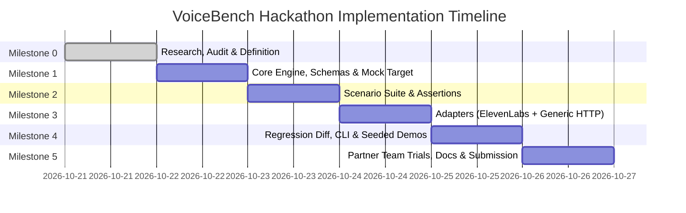

# VoiceBench — Milestone Implementation Plan

**Project:** VoiceBench (FOSS FORGE 2.0 · Build with ElevenLabs)  
**Track:** AI Roundtable Track (Problem 1 Evaluation)  
**Date:** October 21, 2026  
**Status:** Approved for Milestone 0 Planning  

---

## 1. Engineering Roadmap Overview

To maximize judging points while managing hackathon time constraints, VoiceBench follows a disciplined, test-driven development lifecycle:
1. Prioritize working engineering, deterministic evaluation, and reproducible evidence.
2. Build local, offline mock capabilities early to allow rapid testing without rate-limits or API costs.
3. Keep visual dashboards deferred until the core engine, CLI, scenario suite, and regression diffing are fully verified.

---

## 2. Milestone Breakdown

---

### Milestone 0: Research, Originality Audit & Project Definition (Current)
* **Goal:** Establish clean-room baseline, conduct thorough prior art review, select problem track, and document architectural and evaluation specifications.
* **Deliverables:**
  - `docs/PRIOR_ART_REVIEW.md` (Complete audit of existing tools and gap analysis)
  - `docs/PROJECT_DECISION.md` (Selection of Problem 1 AI Roundtable and judging alignment)
  - `docs/EVALUATION_PLAN.md` (6 comprehensive scenarios across 6 failure modes)
  - `docs/ARCHITECTURE.md` (Modular engine, adapter interface, trace and diff specs)
  - `docs/MILESTONE_PLAN.md` (Realistic implementation timeline)
  - `README.md` (Clear project status, architecture overview, and clean-room notice)
* **Exit Gate:** All documents complete, consistent, and approved by team lead. **Zero application code written; zero repositories published.**

---

### Milestone 1: Core Engine, Event Capture & Local Mock Target
* **Goal:** Build the decoupled execution engine and offline fixture runner with zero external dependencies.
* **Deliverables:**
  - Python package structure (`voicebench/core`, `voicebench/models`, `voicebench/adapters`).
  - Scenario parser and schema validation using `pydantic`.
  - Immutable `ConversationTrace` collector capturing timestamps, speaker IDs, transcripts, and audio packet metrics.
  - `LocalMockAdapter` with scripted healthy and defective podcast conversation streams.
  - Automated unit test suite (`pytest`) validating trace capture and event dispatching.
* **Verification Gate:** `pytest tests/test_core.py` passes 100% offline in $<5\text{ seconds}$.

---

### Milestone 2: Deterministic Evaluator & 6-Scenario Test Suite
* **Goal:** Implement deterministic assertion logic, failure categorization, and the six core test scenarios.
* **Deliverables:**
  - Evaluator engine supporting speaker matching, yield latency calculation, keyword anchoring, and tool schema checks.
  - Six YAML scenario files placed in `scenarios/roundtable/`:
    - `SCEN-ROUT-01.yaml` (Addressed-agent routing)
    - `SCEN-INT-02.yaml` (Human barge-in & yield latency)
    - `SCEN-ROLE-03.yaml` (Persona & expertise consistency)
    - `SCEN-REC-04.yaml` (Post-interruption topic recovery)
    - `SCEN-TOOL-05.yaml` (Tool call & fact grounding)
    - `SCEN-COORD-06.yaml` (Turn alternation & dead air detection)
  - Failure categorization engine mapping failures to exact turns and entities.
  - Tri-state outcome support (`PASS`, `FAIL`, `INCONCLUSIVE`).
* **Verification Gate:** Running the suite against `LocalMockAdapter` produces expected deterministic outcomes with turn-level citations.

---

### Milestone 3: Adapter Layer (Generic HTTP/WS & ElevenLabs Integration)
* **Goal:** Enable VoiceBench to connect to real external voice systems without modifying target code.
* **Deliverables:**
  - `GenericHttpAdapter` supporting streaming JSON and audio over HTTP/SSE.
  - `GenericWebSocketAdapter` supporting real-time bidirectional audio/transcript streams.
  - `ElevenLabsAdapter` interfacing with ElevenLabs Conversational AI WebSockets behind the adapter barrier.
  - Environment variable credential management (`ELEVENLABS_API_KEY`).
  - Graceful transport error handling routing to `INCONCLUSIVE` (preventing false fails).
* **Verification Gate:** Live round-trip test against a local mock HTTP server and ElevenLabs sandbox endpoint.

---

### Milestone 4: Regression Comparator (`voicebench diff`), CLI & Seeded Demos
* **Goal:** Deliver the regression engine, developer CLI, and self-contained baseline vs defective demo.
* **Deliverables:**
  - `voicebench diff` CLI command comparing two JSON results files (reporting state flips, $\Delta \text{latency}$, new failure patterns).
  - Human-readable report generators: Markdown summary and clean HTML export.
  - Machine-readable JSON output matching the specification.
  - Packaged Reference Demo Agents:
    - `BaselineAgent`: Passes all 6 scenarios.
    - `DefectiveAgent`: Fails `SCEN-ROUT-01`, `SCEN-INT-02`, and `SCEN-REC-04` with seeded defects.
  - One documented CLI command: `voicebench run --suite ./scenarios --target demo-baseline`.
* **Verification Gate:** Running `voicebench diff baseline_run.json defective_run.json` generates a flawless regression report identifying the 3 seeded regressions.

---

### Milestone 5: Peer Team Validation, Final Documentation & FOSS Submission
* **Goal:** Partner with peer teams building Problem 1 roundtables, finalize documentation, and prepare submission.
* **Deliverables:**
  - Connect VoiceBench to at least one (ideally two) peer hackathon teams' roundtable endpoints, generating real reliability reports for their pitches.
  - If peer teams are unavailable, execute the full fallback demonstration using the Baseline vs Defective agents.
  - Complete documentation requirements:
    - 10-Minute Quickstart Guide.
    - Full Scenario Reference Manual.
    - Metric Definition & Formula Guide.
    - Adapter Integration Guide.
    - Limitations and Known Issues Disclosure.
  - Repository hygiene check: Verify clean Git history, genuine local authorship, no secrets, no vendored code.
  - Tag release and prepare final submission video/pitch.
* **Verification Gate:** Complete independent clean build and test pass on a fresh environment.

---

## 3. Risk Management & Time Buffers

- **Buffer Day:** Milestone 5 includes a full day allocated for testing, documentation review, and submission packaging.
- **Dependency Minimization:** Core engine relies only on standard, lightweight Python libraries (`pydantic`, `pyyaml`, `pytest`, `rich`). No heavy deep learning frameworks or complex database servers required.
- **Clean-Room Enforcement:** Before any Git commit is tagged, the repository is verified against the clean-room originality checklist.
