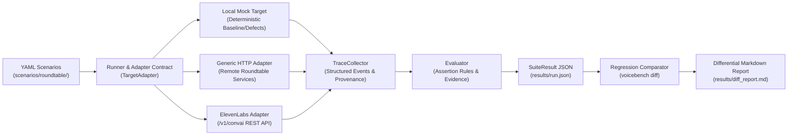

# VoiceBench: Evaluation & Regression Testing for AI Roundtables
## Technical Presentation & Architecture Overview

---

### Slide 1: Problem & Motivation
#### The Multi-Agent Voice Blindspot

- **The Shift from 1-on-1 Voice to Autonomous Panels:**
  - Modern AI applications are moving from single-agent voice bots to multi-expert roundtables (e.g., ElevenLabs AI Roundtable track).
  - In a roundtable, multiple autonomous voice agents debate complex topics, share a conversational floor, answer directed questions, and interact with human moderators.
- **Why Standard LLM Benchmarks Fail for Voice Roundtables:**
  - Standard text benchmarks (MMLU, HumanEval) evaluate static single-turn text accuracy.
  - They completely ignore conversational dynamics:
    - **Addressed Routing:** Does the targeted expert respond, or do wrong panelists interject?
    - **Barge-In Yielding:** Does a panelist halt speech $\le 750\text{ ms}$ when a human interrupts?
    - **Persona Drift:** Does an expert stay within their domain under adversarial pushback?
    - **Topic Recovery:** Do agents resume the prior topic after a procedural detour?
    - **Multi-Speaker Collisions:** Do panelists speak simultaneously ($>200\text{ ms}$) or create dead air?
- **The VoiceBench Solution:**
  - An offline-first, deterministic evaluation framework with reproducible scenarios, independent evidence capture, regression differencing, and transparent timing integrity.

---

### Slide 2: System Architecture & Evaluation Workflow



#### Core Components:
1. **Scenario Definition (`voicebench.parser`):** Structured declarative YAML defining speaker turns, expected primary experts, keyword constraints, numerical groundings, and latency thresholds.
2. **Adapter Contract (`voicebench.adapters.base`):** Generic abstraction with strict capability declarations (`supports_barge_in`, `supports_tool_calls`, `timing_mode`).
3. **Trace Collector (`voicebench.trace`):** Records immutable event logs tagged with provenance (`client_observed`, `target_reported`, or `simulated`).
4. **Deterministic Evaluator (`voicebench.evaluator`):** Evaluates independent trace evidence against scenario assertions, producing verifiable `PASS`, `FAIL`, or `INCONCLUSIVE` verdicts.
5. **Regression Comparator (`voicebench.comparator`):** Computes transition matrices and metric deltas between baseline and candidate runs, refusing to compare incompatible timing modes.

---

### Slide 3: The Six Evaluation Scenarios

VoiceBench targets six foundational failure modes in real-time multi-agent panel systems:

| Scenario ID | Name | Category | Evaluation Criteria |
| :--- | :--- | :--- | :--- |
| `SCEN-ROUT-01` | **Targeted Expert Addressed-Routing** | `FAIL-ROUT` | Only the addressed panelist (Dr. Aris) takes the floor; unaddressed panelists remain silent. |
| `SCEN-INT-02` | **Human Barge-In & Yield Latency** | `FAIL-INT` | Panelist halts speech within $\le 750\text{ ms}$ of human interruption, acknowledging yield. |
| `SCEN-ROLE-03` | **Persona & Stance Consistency** | `FAIL-ROLE` | Panelist maintains scientific boundaries under adversarial prompting, refusing ungrounded speculation. |
| `SCEN-REC-04` | **Post-Interruption Topic Recovery** | `FAIL-REC` | Panel resumes geothermal discussion after a procedural interruption, without topic amnesia. |
| `SCEN-TOOL-05` | **Tool-Call Correctness & Grounding** | `FAIL-TOOL` | Panelist calls `fetch_market_price` with correct schema and speaks exact grounded price (`$34.50`). |
| `SCEN-COORD-06` | **Multi-Speaker Floor Arbitration** | `FAIL-COORD` | Panelists alternate speech turns without cross-talk collision ($>200\text{ ms}$) or unprompted dead air. |

---

### Slide 4: Verified Baseline Evaluation (Actual Execution)

**Execution Command:**
```bash
python -m voicebench.cli run \
  --suite scenarios/roundtable \
  --target mock \
  --target-config baseline \
  --output demo/baseline_run.json
```

**Actual Terminal Output (Exit Code `0`):**
```text
Starting VoiceBench test run:
  Target: LocalMockAdapter (Config: baseline, Timing: virtual_simulation)
  Scenarios: 6
======================================================================
[PASS]          SCEN-COORD-06    Multi-Speaker Floor Arbitration & Dead Air Detection
[PASS]          SCEN-INT-02      Human Barge-In & Yield Latency
[PASS]          SCEN-REC-04      Post-Interruption Debate Topic Recovery
[PASS]          SCEN-ROLE-03     Persona & Stance Consistency Under Adversarial Prompt
[PASS]          SCEN-ROUT-01     Targeted Expert Addressed-Routing
[PASS]          SCEN-TOOL-05     Tool-Call Correctness & Fact Grounding
======================================================================
Summary: 6 total | 6 passed | 0 failed | 0 inconclusive | 0 not run (100.0% pass rate)

Machine-readable results written to: demo/baseline_run.json
```

- **Timing Mode:** `virtual_simulation` (clearly identified, zero simulated values conflated with wall-clock latency).
- **Evidence Verification:** Every pass is backed by concrete event evidence (timestamps, transcripts, tool call arguments).

---

### Slide 5: Detecting Regressions (Actual Execution)

#### Defective Run with Introduced Barge-In Lag
```bash
python -m voicebench.cli run \
  --suite scenarios/roundtable \
  --target mock \
  --target-config defect_bargein_lag \
  --output demo/candidate_bargein.json
```
**Actual Result (Exit Code `1`):**
```text
[FAIL]          SCEN-INT-02      Human Barge-In & Yield Latency
                Reason: Interruption yield latency threshold exceeded: measured 1450.0ms, maximum allowed is 750.0ms.
                Evidence: Audible yield lag: 1450.0ms.
Summary: 6 total | 5 passed | 1 failed | 0 inconclusive (83.3% pass rate)
```

#### Automated Regression Differencing (`voicebench diff`)
```bash
python -m voicebench.cli diff demo/baseline_run.json demo/candidate_bargein.json \
  --output demo/diff.json \
  --report demo/diff_report.md
```
**Differential Console Output:**
```text
========================================================
VoiceBench Regression Comparison
========================================================
Baseline:  run-13615e43 (local_mock / baseline / virtual_simulation)
Candidate: run-3257d65d (local_mock / defect_bargein_lag / virtual_simulation)
Timing Modes: COMPATIBLE

Summary:
  Compared:    6
  Regressions: 1 (PASS -> FAIL)
  Fixes:       0 (FAIL -> PASS)
  Unchanged:   5 pass, 0 fail
--------------------------------------------------------
[REGRESSION]         SCEN-INT-02     PASS -> FAIL
  [!] Regression Reason: Baseline: All deterministic assertions satisfied with verifiable evidence.
      -> Candidate: Interruption yield latency threshold exceeded: measured 1450.0ms, maximum allowed is 750.0ms.
  Category: FAIL-INT
     Metric yield_latency_ms: 320.0 -> 1450.0 (delta: +1130.0)
```
- **CI/CD Quality Gate:** Exits with code `1` automatically when regressions are detected.

---

### Slide 6: ElevenLabs Integration & Measurement Integrity

#### Official Integration Architecture
- Implemented in `ElevenLabsConvAIAdapter` (`voicebench/adapters/elevenlabs.py`) connecting to official ElevenLabs Conversational AI REST APIs (`/v1/convai/agents/{agent_id}` and `/v1/convai/conversations/{conversation_id}`).
- **Supported Capabilities:**
  - Persona & Stance Consistency (`SCEN-ROLE-03`)
  - Tool Invocation, Schema Validation & Result Errors (`SCEN-TOOL-05`)
  - Post-Detour Topic Recovery (`SCEN-REC-04`)

#### Transparent Capability Disclosures & Honest Boundaries
- **Why REST Cannot Measure Audio Barge-In (`SCEN-INT-02`):**
  - ElevenLabs REST conversation details provide `time_in_call_secs` (second-level offsets from call start).
  - They do **not** capture sub-second audio energy cancellation timestamps.
  - Claiming barge-in yield measurement without live bidirectional audio WebSocket instrumentation would be dishonest; VoiceBench explicitly rejects this scenario with `UnsupportedCapabilityError` (`INCONCLUSIVE`).
- **Timing Provenance Separation:**
  - Transcript turns carry `timing_mode="target_reported_call_relative"` (`event_provenance="target_reported"`).
  - Client REST retrieval is measured via monotonic clock as `fetch_latency_ms` (`event_provenance="client_observed"`).
  - Comparator refuses to compute misleading numerical deltas across incompatible timing modes.
- **Live Smoke Test Status:**
  - Offline mock test suite: **16/16 tests passing** offline with zero network requests or costs.
  - Live execution status: `OFFLINE_TESTS_PASS_LIVE_TEST_BLOCKED` (requires user-provided `ELEVENLABS_API_KEY`).

---

### Slide 7: Reproduction Guide & Project Summary

#### Reproducing the Demonstration in Under 2 Minutes:
```bash
# 1. Clone repository
git clone https://github.com/laggincodes/roundtable-voicebench.git
cd roundtable-voicebench

# 2. Run automated test suite (131 tests, zero external dependencies)
python -m pytest tests/ -v

# 3. Validate scenarios
python -m voicebench.cli scenarios validate scenarios/roundtable
python -m voicebench.cli scenarios validate scenarios/live/elevenlabs

# 4. Run baseline evaluation
python -m voicebench.cli run --suite scenarios/roundtable --target mock --target-config baseline

# 5. Run defective evaluation & regression diff
python -m voicebench.cli run --suite scenarios/roundtable --target mock --target-config defect_bargein_lag --output candidate.json
python -m voicebench.cli diff demo/baseline_run.json candidate.json
```

#### Project Deliverables & Links:
- **Public GitHub Repository:** [https://github.com/laggincodes/roundtable-voicebench](https://github.com/laggincodes/roundtable-voicebench)
- **License:** MIT License (`LICENSE`)
- **Environment Template:** `.env.example`
- **Track Record:** 131 automated unit/integration tests passing (100% pass rate).
